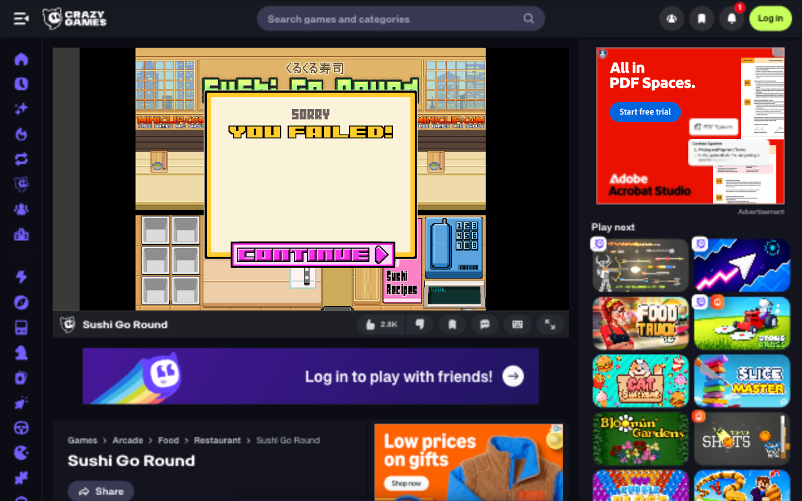

# Tiny hand-authored Sushi Go Round agent

**Status: does not yet pass Day 1 reliably; no pass was verified in eight live
attempts.** Best observed cash was ¥940, but that run failed on reputation.
This is a working experimental browser agent, not a successful finished solution.
See the [machine-readable results](evaluations/summary.json) and
[final failure screenshot](evaluations/latest-result.png).

## Results

Live evaluation on November 3, 2026 used the
[CrazyGames version of Sushi Go Round](https://www.crazygames.com/game/sushi-go-round).
Across eight attempts, **zero Day 1 passes were verified**. The highest observed
cash was **¥940**, above the ¥800 money target, but that attempt still ended in
failure after reputation depleted. This is a failed proof of concept, not a
successful game-playing benchmark.

The first two attempts used assistant-transcribed observations. Later attempts
used hand-coded pixel features and browser automation, with some manual repairs
and corrections. These mixed conditions mean the eight attempts cannot be used
as a controlled autonomous success-rate measurement. Decision logs and saved
state snapshots are included in [evaluations](evaluations/).



The policy is an 11-coefficient linear action ranker. All coefficients were
written and revised directly by the assistant. No training, fitting, optimizer,
gradients, pretrained vision network, or automated parameter search was used.
The coefficients alone occupy 44 bytes as float32; JSON, Python, Pillow,
perception, inventory memory, and browser transport are additional overhead.

## Setup and execution

```sh
python3 -m venv .venv
.venv/bin/pip install -r requirements.txt
python3 evaluations/check_policy.py
# Rank externally supplied action candidates (JSONL):
python3 sushi_policy/policy.py < observations.jsonl
# Read one saved 1280x800 game screenshot and choose an action:
.venv/bin/python -m sushi_policy.auto /absolute/path/screenshot.png
```

The screenshot command outputs a JSON action with a `clicks` sequence. It persists
inventory and pending-food estimates in `evaluations/auto-state.json`. Move that
file aside before each fresh Day 1. `evaluations/browser-harness.js` connects this
command to T3 preview tools supplied by the host; it is not a standalone browser
or an installed browser extension. Invoke it only after starting a fresh day.
The fixed coordinates assume the CrazyGames game occupies x216–775, y76–496
inside a 1280×800 viewport. Resizing or scrolling invalidates that calibration.

The browser harness reads screenshots and performs normal clicks. It never
changes game cash, inventory, timers, customers, or win conditions. It uses no
hidden game state. Recipe clicks wait for rolling; phone menus have additional
spacing. Runtime order/stock memory is game state estimation, not learned weights.

## Components

- `sushi_policy/policy.py`: standard-library dot product and legal-action argmax.
- `sushi_policy/weights.json`: final hand-written coefficients; earlier versions
  are preserved beside it.
- `sushi_policy/adapter.py`: three recipes, legal actions, and calibrated clicks.
- `sushi_policy/vision.py`: manually specified color thresholds for visible order
  icons, mood indicators, plates, belt food, and the closing-time marker.
- `sushi_policy/auto.py`: state estimation and one screenshot-to-action step.
- `evaluations/*decisions*.jsonl`: observations and selected actions from play.

## Rules actually inspected

The live tutorial, recipe book, and Day 1 goal screen were inspected on CrazyGames.
Day 1 requires ¥800 or more and maintaining restaurant reputation. Purchases
reduce displayed cash. Customers keep waiting while the recipe book is open;
sake is described as temporarily helping mood. Finished plates must be cleared.

| Dish | Rice | Nori | Roe |
| --- | ---: | ---: | ---: |
| Onigiri | 2 | 1 | 0 |
| California roll | 1 | 1 | 1 |
| Gunkan maki | 1 | 1 | 2 |

## Direct weight edits and evaluation

Initial synthetic checks exposed duplicate production, so `already_on_belt`
was changed from 0 to -12. Live attempts motivated increasing plate clearing
and refill priority. Later direct edits raised urgency to 12, set clearing to 8,
set refill benefit to 16, and increased purchase-cost penalty to -30. These are
manual edits, not training. The final action score is:

```text
10 orders_served + 12 urgency - 12 already_on_belt - 5 waste
- 6 stockout_risk + 16 refill_value - 30 cost_fraction
+ 8 clears_seat - 0.1 action_seconds - 1000 unaffordable
```

Bias is zero. Impossible recipes/purchases should also be marked illegal.
Cost features include a larger near-closing penalty; feature extraction and
control logic are explicit code outside the 11 coefficients.

Eight live attempts were made during the retry. The first two used assistant-
transcribed screenshot observations. Later attempts used the pixel observer;
several adapter repairs and final corrections were assisted. Multiple runs met
the money goal but failed reputation. This is not a measured autonomous success
rate or proof of generalization. Synthetic probes in `evaluations/probes.json`
check intended rankings only, not game performance.

The main remaining problems are stock estimates drifting when clicks are missed,
food being assigned to the wrong waiting customer, and delays in screenshot/tool
transport. Pending-food and belt estimates need better visible feedback before
further weight tuning is likely to help. Final result screenshots showed failure;
no Day 2 screen was observed.
